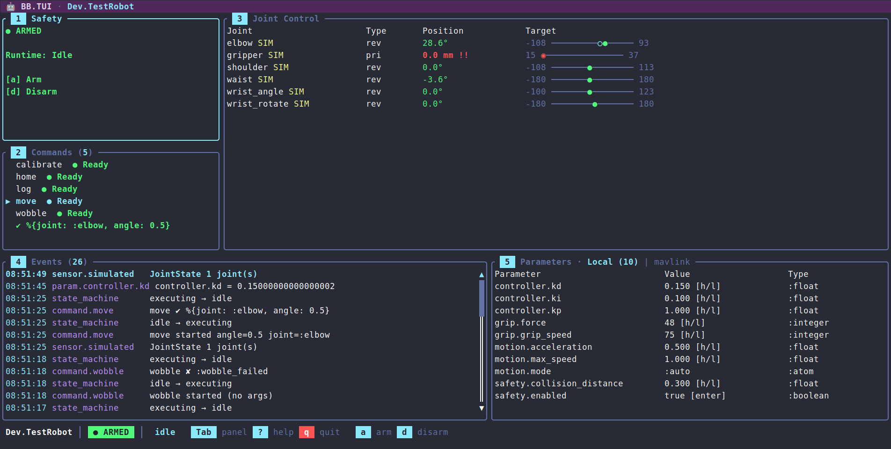

# BB.TUI

[](https://hex.pm/packages/bb_tui)
[](https://hexdocs.pm/bb_tui)
[](https://github.com/mcass19/bb_tui/actions/workflows/ci.yml)
[](https://github.com/mcass19/bb_tui/blob/main/LICENSE)

Terminal-based dashboard for [Beam Bots](https://github.com/beam-bots) robots. Built on [ExRatatui](https://github.com/mcass19/ex_ratatui).



## Features

- **Safety controls** — arm / disarm / force disarm with confirmation popup
- **Joint control panel** — position table with type (revolute/prismatic/continuous), units (degrees/mm), visual range bars, target tracking, simulated joint markers, and direct position adjustment via keyboard (1% and 10% steps)
- **Event stream** — scrollable, color-coded event list with formatted timestamps and message summaries; pause/resume, clear, and Enter to open a detail popup showing full payload. Surfaces hardware-error detail (`[:safety, :error]`) and estimator output (`[:estimator]`) alongside state, sensor, parameter, and command events
- **Commands panel** — lists available robot commands with Ready/Blocked indicators based on runtime state, and a Running badge on any command running on the robot, whoever started it (`c` cancels it). Argument-less commands execute on Enter; commands with declared arguments open an inline edit mode (Tab to cycle fields, type-to-edit, Enter to run, Esc to cancel). Argument types — boolean, integer, float, atom, enum (`{:in, [...]}`), string — are parsed before dispatch
- **Parameters panel** — live parameter table grouped by path with real-time updates and the selected parameter's `doc` on the panel border. Numeric and unit-typed values step by 1% / 10% of their declared range with `h`/`l`/`H`/`L`, booleans toggle on Enter, string and atom values open an inline editor, and `{:in, [...]}` fixed-set parameters cycle through their allowed values. Bridge tabs expose remote parameters for numeric stepping and boolean toggling
- **Controllers tab** — every controller the robot declares, whether it is running, and its state, pretty-printed on demand
- **3D visualization tab** — renders the live robot in the terminal from its URDF topology and joint positions, with an orbitable/zoomable camera. Built on `ExRatatui`'s `Viewport3D`: crisp pixel graphics on capable terminals (Ghostty/WezTerm/Kitty) with automatic braille fallback over SSH; the arm reposes in real time as sensor data arrives
- **High-rate-safe** — the event log debounces repeated sensor messages and renders coalesce to ~30fps, so fast telemetry never floods the log or stalls the UI
- **Status bar, help overlay, and theming** — robot name / safety / runtime indicators, who holds the wheel, a battery / power readout when the robot reports it (colored by remaining charge), the link's round trip under `node:`, a scrollable keybinding reference, and a consistent semantic color palette
- **Keyboard-driven navigation** — `[`/`]` to switch between the Control Panel, Visualization, Controllers and extension tabs, Tab to cycle panels, number keys to jump, vim-style `j`/`k`/`h`/`l` within panels
- **Five transports** — local terminal, SSH (a daemon or a `nerves_ssh` subsystem, with isolated operator sessions), an IEx shell over SSH or `--remsh`, Erlang distribution (render here with `node:`, or attach a thin renderer to a TUI on the robot node), and the browser (`use BB.TUI.Live` in a Phoenix LiveView, via the optional `phoenix_ex_ratatui` dependency)
- **Runtime inspection** — snapshot, trace, and inject events into a running TUI via `ExRatatui.Runtime`
- **Driving** — an extension's drive turns the arrows into a hold-to-drive pad on its own tab, working on every transport, with key releases where the terminal reports them and autorepeat inference otherwise; a pilot lease keeps it to one driver per robot across sessions and nodes, and also lets a velocity-only joint (a wheel) spin from the Joints panel while `h`/`l` is held. See the [Driving guide](guides/driving.md)
- **Robot and kit extensions** — a `use BB.TUI.Extension` module, passed as `extensions:`, declares hold-to-drive, panels of live readouts, plots and attitude indicators, keys bound to commands, and per-state hints for a particular robot; bb_tui renders them with its own widgets and never names the kit. See the [Extensions guide](guides/extensions.md)
- **Extensible rendering** — register `BB.TUI.Renderer` modules per PubSub path prefix (`:renderers`) to render a consumer's own payloads in the event log and status bar, without bb_tui depending on their structs
- **Mix task** — `mix bb.tui --robot MyApp.Robot` for standalone launch
- **Headless test suite** — full coverage using Mimic and ExRatatui's test backend

## Layout

```
 🤖 BB.TUI · MyApp.Robot                                                  ← title bar
╭ Safety ────────╮╭ Joint Control ────────────────────────────────────╮
│ ● ARMED        ││ Joint       Type  Position    Target              │
│ Runtime: Idle  ││ elbow       rev   -63.8°      -90 ─────●────── 90 │  60%
│ a  arm         ││ gripper SIM pri    30.6 mm      0 ─────●────── 50 │  height
│ d  disarm      ││ wrist       rev    87.0° !    -90 ──────────◆─ 90 │
├ Commands (2) ──┤│ ...                                               │
│ ▶ home  ● Ready││                                                   │
│   calibrate    ││                                                   │
╰────────────────╯╰───────────────────────────────────────────────────╯
╭ Events (47) ───╮╭ Parameters ───────────────────────────────────────╮
│ 18:23:12 sensor.sim       JointState 2 joint(s)                    ││
│ 18:23:11 state_machine    disarmed → armed                         ││
╰────────────────────────────────────────────────────────────────────╯╯
 MyApp.Robot │ ● ARMED │ idle │ 🔋 78%   Tab panel  ? help  q quit  a arm  d disarm
```

That is the Control Panel tab. Pressing `]` switches to the Visualization tab, which renders the live robot in 3D from its URDF topology and joint positions — orbitable, zoomable, and re-posed in real time as sensor data arrives — then to the Controllers tab when the robot declares controllers, and to the tabs its extensions add: a Drive tab with the hold-to-drive pad, and panels of live readouts, charts and attitude indicators.

## Installation

Use [Igniter](https://hex.pm/packages/igniter) to add `bb_tui` to a project. The installer imports formatter rules and prints a launch notice tailored to the chosen install shape. If the project already has a `BB` robot module (typically scaffolded by `mix igniter.install bb`):

```sh
mix igniter.install bb_tui
mix igniter.install bb_tui --robot MyApp.Arm
```

The install shape can be tuned with flags:

- `--auto-bb` — scaffold a `BB` robot via `bb.install` when none is present (skips the interactive prompt).
- `--ssh` — append a supervised `{BB.TUI, …}` child wired for an SSH daemon, so the dashboard is reachable as soon as the app boots. Accepts `--port`, `--user`, `--password`. Idempotent; change the generated credentials before deploying.
- `--nerves` — register `BB.TUI.subsystem(<Robot>)` under `config :nerves_ssh, :subsystems` so the dashboard rides on an existing `nerves_ssh` daemon.
- `--web` — serve the dashboard in the browser: adds the optional `phoenix_ex_ratatui` dependency, generates a `use BB.TUI.Live` LiveView under the web namespace, mounts it inside the router's `:browser` scope (`/robot` by default, or `--path`), and registers the JS hook in `assets/js/app.js`. Needs a Phoenix router; idempotent.

Local dashboards are not supervised — a child that claims the terminal on boot would fight an IEx session for stdin/stdout — so the local entry points are `mix bb.tui` and `BB.TUI.run/1`. See `mix help bb_tui.install` for the full option reference, and the [Transports guide](guides/transports.md) for SSH, browser, and distribution setups.

To skip Igniter, add the dep directly:

```elixir
def deps do
  [
    {:bb_tui, "~> 0.8"}
  ]
end
```

## Quick Start

Standalone, via the mix task:

```sh
mix bb.tui --robot MyApp.Robot
```

From IEx:

```elixir
BB.TUI.start(MyApp.Robot)
```

Under a supervision tree:

```elixir
children = [
  {BB.Supervisor, MyApp.Robot},
  {BB.TUI, robot: MyApp.Robot}
]
```

In the browser, with the optional `{:phoenix_ex_ratatui, "~> 0.4"}` dependency added next to `bb_tui`:

```elixir
defmodule MyAppWeb.RobotLive do
  use BB.TUI.Live, robot: MyApp.Robot
end

# router.ex
live "/robot", MyAppWeb.RobotLive
```

With a robot's extension, on any of them:

```elixir
BB.TUI.run(MyApp.Robot, extensions: [MyApp.TUI])
```

Serving the dashboard over SSH or in the browser, or attaching to a robot on another BEAM node, is covered in the [Transports guide](guides/transports.md). The full key reference lives in the [Keybindings guide](guides/keybindings.md) (and in the in-app `?` overlay).

## Transports

| Transport | Start it with | Key releases (for driving) |
|---|---|---|
| Local terminal | `mix bb.tui`, `BB.TUI.run/2` | from terminals speaking the kitty keyboard protocol (Ghostty, kitty, WezTerm, foot, Alacritty, iTerm2); inferred from autorepeat elsewhere |
| SSH | `BB.TUI.start_ssh/2`, or `BB.TUI.subsystem/2` on `nerves_ssh` | as the client's terminal reports them |
| IEx shell over SSH or `--remsh` | `BB.TUI.run/2` from that shell | as the client's terminal reports them |
| Browser | `use BB.TUI.Live` | always |
| Erlang distribution | `node:` on any of the above, or `ExRatatui.Distributed.attach/3` | as the local terminal reports them (`attach/3` takes `keyboard_enhancement: true`) |

bb_tui asks for key releases itself whenever an extension declares a drive; without them, driving still works and stops within 150 ms of letting go. See the [Driving guide](guides/driving.md).

## How It Works

BB stores state in ETS and publishes changes over PubSub. The TUI subscribes to the `[:state_machine]`, `[:sensor]`, `[:param]`, `[:actuator]`, `[:command]`, `[:safety]`, and `[:estimator]` paths, takes a one-time ETS snapshot on mount, then keeps state fresh from PubSub messages. This subscription set is configurable — passing `:subscribe_paths` to `BB.TUI.run/2` points the dashboard at a narrower or downsampled set of paths instead. Most paths drive dedicated panels; `[:safety, :error]` hardware-error reports and `[:estimator]` output flow into the event log. A consumer can override that fallback for paths it owns by passing `:renderers` — a `%{prefix => module}` map of `BB.TUI.Renderer` implementations — so its own payloads get a custom event-log summary (and an optional status-bar readout) without bb_tui depending on their structs; messages route to a renderer by longest-matching prefix. Keyboard events call BB APIs directly (safety, actuator, parameters, command execution) — there are no optimistic updates, so the dashboard is a faithful reflection of the robot's actual state. Each call that waits on the robot runs off the dashboard's event loop, so an arm sequence or a slow bridge never freezes the UI, and a refusal — a disarmed jog, an `:already_armed`, a parameter value of the wrong type — lands in the event log.

All state transitions live in `BB.TUI.State` as pure functions — no side effects, no process communication — which makes the dashboard easy to test headlessly. `BB.TUI.App` wires input and async results to those transitions through ExRatatui's reducer runtime.

Robots can publish sensor data faster than a terminal can usefully redraw, so the event log debounces repeats of the same `{path, payload-type}` within a one-second window (command and state-machine events are never debounced, and a repeated parameter change replaces its earlier row so the log shows where it ended up), and sensor-driven renders coalesce to at most one frame every ~33ms (~30fps). Key presses, command results, and safety/parameter/state changes still render immediately. Both windows are fields on `BB.TUI.State.Throttle`.

The Visualization tab is built the same way — as a pure projection of state. `BB.TUI.Viz.RobotScene` reads the robot's URDF topology and the live joint configurations, hands them to bb core's `BB.Robot.Kinematics` for base-frame link transforms — so every joint type poses correctly, planar and floating included — and emits an `ExRatatui.ThreeD` scene of the robot's links; `BB.TUI.Panels.Visualization` hands that scene, plus the orbit camera and render mode held in `BB.TUI.State.Viz`, to ExRatatui's `Viewport3D` widget. Every sensor frame that moves a joint re-runs the kinematics, so the on-screen arm tracks the real one. `Viewport3D` picks the sharpest pixel protocol the terminal advertises (kitty / sixel / iTerm2) and falls back to half-block, braille, or ASCII when those aren't available — which is why the view stays usable over SSH; the `m` key forces a specific mode.

## Running commands

Commands dispatched from the UI are awaited with `:infinity`, so a continuous command — one that only returns when it stops or is cancelled — is never reported as timed out while it is still running. Runaways stay bounded by the command's own DSL `timeout`. Press `c` in the commands panel to cancel the selected command while it runs — including one started from another session, a browser tab or automation; the event log then shows the cancellation.

## Development

The project ships a simulated WidowX-200 robot arm that starts automatically in dev:

```sh
mix deps.get
mix bb.tui --robot Dev.TestRobot
```

`Dev.TestRobot` exercises every panel feature end-to-end:

- Commands with all argument shapes — `home` (no args), `move` (enum + float), `log` (string + integer), `wobble` (always returns `{:error, :wobble_failed}`), `calibrate` (runs ~2s, so it shows as Running and `c` can cancel it), and `stream` (emits a high-rate `JointState` burst to show debounce + render coalescing).
- Real actuators on `waist`, `shoulder` and `elbow` (`Dev.Servo`, swapped for bb's simulated actuator in kinematic simulation, with an open-loop position estimator each), so jogging them goes through bb's actuator path: refused while disarmed, one jog in flight per actuator, late answers logged as warnings. The wrist and gripper have none and show `SIM`, driven by the dashboard's simulated `JointState` fallback.
- Telemetry demos — `power` (drains a simulated battery so the status-bar readout shifts green → yellow → red) and `diagnostics` (publishes a `[:safety, :error]` hardware-error report and an `[:estimator]` pose so both surface in the event log).
- A multi-DoF demo — the arm rides a planar `base_motion` joint, and `drive` sends the base around a ~3s circle of `Transform2D` poses: the joints panel shows the read-only `pla` row tracking the pose, the event stream renders it compactly as `(x, y, θ°)`, and the 3D view shows the whole arm driving the loop.
- A trajectory demo — `trajectory` publishes a `BB.Message.Actuator.Command.Trajectory` per joint and then sweeps `shoulder` and `elbow` through those waypoints over ~2.4s: the event log summarizes each command as `shoulder ← trajectory 4 waypoints over 2400ms` and lists the waypoints as `position@time`, while the arm moves through them instead of snapping between targets.
- Parameter groups covering every shape the panel knows — float, integer, boolean, atom, string, unit-typed (`motion.cruise_speed` in m/s, `controller.trim` in degrees with bounds declared in radians), and a fixed-set `gait.pattern` (`{:in, [:walk, :trot, :crawl]}`, registered by `Dev.GaitSelector`) — most with `:min` / `:max` so 1%-of-range stepping applies, and every one carrying a `doc` for the panel border.
- A `:mavlink` bridge (`Dev.MockBridge`) with a fixed remote-parameter list and in-memory writes — press `t` in the Parameters panel to cycle to the Bridge tab.
- An extension — `Dev.TUI` (`dev/tui.ex`) adds Drive, Oscillator and Telemetry tabs of live readouts and charts: joints in degrees with an attitude horizon driven by the shoulder and waist, a parameter, the `[:drive]` topic in cm/s, and the state of `Dev.Oscillator`, a controller that publishes nothing (also listed, with its state on Enter, in the Controllers tab); `w` runs `wobble` from any tab, and a hint banner follows the runtime state. It loads in the browser and distributed dev sessions, and with `mix bb.tui --robot Dev.TestRobot --extension Dev.TUI`.
- A browser dashboard — the dev application also serves `Dev.TestRobot` through `BB.TUI.Live` at `http://localhost:4040` (`dev/web/`, npm-free), so the same robot can be driven from a terminal and a browser tab at once.

The WidowX-200 ships a full URDF, so the Visualization tab is live in dev too — press `]` to switch to it, then move joints from the Joint Control panel, run `stream` to watch the 3D arm repose in real time, run `trajectory` to watch it sweep smoothly through a set of waypoints, or run `drive` to watch it tour the ground plane.

Exercising the SSH, browser, and Erlang-distribution transports against the simulated robot is covered in the [Transports guide](guides/transports.md#testing-transports-locally).

## Guides

| Guide | Description |
|---|---|
| [Transports](guides/transports.md) | Serve the dashboard over SSH or in the browser, attach over Erlang distribution, inspect a running session, and test each transport locally |
| [Driving](guides/driving.md) | Hold-to-drive with the arrow keys: the Drive tab, the pilot lease, repeat and release modes, when driving stops, and spinning a wheel from the Joints panel |
| [Extensions](guides/extensions.md) | Add a robot's drive, panels of readouts, charts and attitude indicators, key binds and hints with a `BB.TUI.Extension`, and wire it into every transport |
| [Keybindings](guides/keybindings.md) | Full per-panel key reference, including command argument editing, parameter stepping, and inline parameter editing |
| [Telemetry](guides/telemetry.md) | `:telemetry` events for mount, input, dispatch, and frames — logging and `Telemetry.Metrics` |

## Contributing

See [CONTRIBUTING.md](CONTRIBUTING.md) for development setup and guidelines.

BB.TUI is built on [ExRatatui](https://github.com/mcass19/ex_ratatui) - a general-purpose terminal UI library for Elixir, and [Beam Bots](https://github.com/beam-bots) - robotics framework. Contributions to underlying libraries are very welcome too.

## License

Apache-2.0 — see [LICENSE](https://github.com/mcass19/bb_tui/blob/main/LICENSE).
